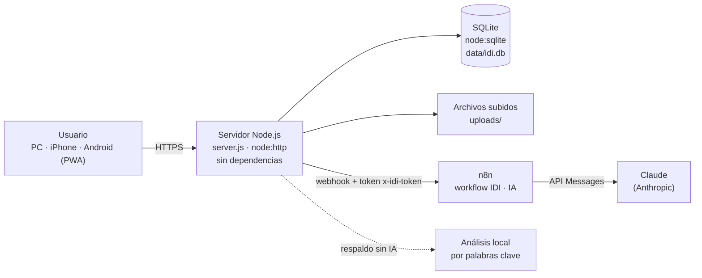
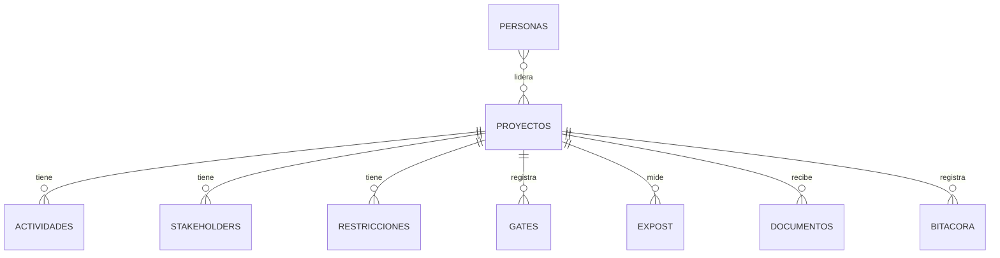

# Arquitectura y diseño técnico · SIGRA Trazabilidad I+D+i

**Autor:** Daniel Durán · Líder de Innovación · 2 de noviembre de 2026 · Versión del software: v5

## 1. Vista general

| Pieza | Tecnología | Responsabilidad |
|---------------|-----------------------------------|--------------------------------------------------|
| Interfaz | HTML, CSS y JavaScript en módulos; gráficos SVG propios; PWA instalable | Tablero, figuras, formularios, diseño adaptable |
| Servidor | Node.js 24 (`node:http`), sin paquetes externos | API REST, cálculo de ruta crítica, salud y alertas, autenticación y permisos |
| Base de datos | SQLite integrado en Node.js (`node:sqlite`) | Proyectos, actividades, stakeholders, riesgos, gates, documentos, bitácora y usuarios |
| IA | n8n + Claude (`claude-sonnet-5-5`) | Clasificar documentos, proponer cambios y responder al asistente |
| Respaldo | Analizador local por palabras clave | Funcionar sin IA cuando n8n no responde |

## 2. Modos de ejecución

| Modo | Cómo se inicia | Acceso | Seguridad |
|------------|----------------------|------------------------------|------------------------------------|
| Local | `iniciar.bat` | Solo el PC (127.0.0.1) | No requiere inicio de sesión |
| Red local | `iniciar-red.bat` | Celulares en la misma Wi-Fi | PIN, cookie de 30 días, bloqueo tras 5 intentos, solo direcciones privadas |
| Público | `IDI_PUBLICO=1` (Render) | Internet: https://sigra-idi.onrender.com | Usuario y contraseña, roles, sesiones firmadas, CSP y HSTS |

## 3. Modelo de datos

| Tabla | Campos principales |
|-----------------|-----------------------------------------------------------------------------------|
| `proyectos` | código, nombre, línea, tipo de innovación, horizonte, etapa (0–6), estado, líder, patrocinador, fechas, presupuesto, ejecutado, VPN esperado, probabilidad técnica y comercial, TRL, cinco criterios de puntaje, decisión final, lecciones |
| `actividades` | proyecto, etapa, nombre, responsable, inicio, fin, avance, es hito, predecesoras (lista de ids), notas |
| `stakeholders` | proyecto, nombre, organización, rol, poder (1–5), interés (1–5), postura, expectativa, estrategia de comunicación |
| `restricciones` | proyecto, tipo, título, descripción, origen, probabilidad (1–5), impacto (1–5), mitigación, responsable, estado |
| `gates` | proyecto, etapa origen y destino, fecha, decisión, comentario, decidido por |
| `expost` | proyecto, indicador, meta, real, unidad, «mayor es mejor» |
| `documentos` | proyecto, nombre, tipo, estado, texto extraído, propuesta de la IA, modo (n8n o local) |
| `bitacora` | proyecto, fecha, acción, detalle, origen (manual, ia, sistema) |
| `usuarios` | usuario, nombre, rol, sal y hash scrypt, versión de sesión, activo |
| `personas`, `config` | Equipo base y configuración (URLs de n8n, modo de IA, empresa) |

## 4. Reglas de cálculo

| Cálculo | Regla |
|------------------------|----------------------------------------------------------------------------|
| Ruta crítica | Holgura calculada con las fechas y las dependencias de las actividades; crítica = holgura 0 |
| rVPN | VPN esperado × probabilidad técnica × probabilidad comercial |
| Salud del proyecto | Suma de puntos por críticas atrasadas, gate vencido, riesgos altos y sobreejecución: verde 0–1, amarillo 2–6, rojo ≥ 7 |
| Riesgo alto | Probabilidad × impacto ≥ 15 |
| Puntaje de portafolio | Cinco criterios de 1 a 5 (estrategia, mercado, técnica, capacidad, bajo riesgo) llevados a 0–100 |

## 5. API principal

| Método y ruta | Uso | Permiso en modo público |
|------------------------------------------|---------------------------------|-------------------------|
| `GET /api/todo` | Todos los datos y cálculos para la interfaz | Cualquier usuario con sesión |
| `POST/PUT/DELETE /api/proyectos`, `/api/actividades`, `/api/stakeholders`, `/api/restricciones`, `/api/expost`, `/api/personas` · `POST /api/proyectos/:id/gate` | Crear, editar, eliminar y registrar decisiones de gate | Editor o administrador |
| `POST /api/documentos` · `POST /api/documentos/:id/aplicar` | Subir documento y aplicar la propuesta aprobada | Editor o administrador |
| `POST /api/asistente` | Pregunta al asistente | Editor o administrador |
| `GET/PUT /api/config` · `POST /api/config/probar` | Configuración de la IA | Lectura: todos · cambios y prueba: administrador |
| `GET/POST/PUT/DELETE /api/usuarios` | Gestión de usuarios | Administrador |
| `POST /api/login` · `POST /api/logout` · `GET /api/yo` | Sesión | Público / con sesión |
| `GET /healthz` | Verificación del servicio | Público |

Toda modificación exige además la cabecera `x-idi: 1` (protección CSRF).

## 6. Flujo de la IA

1. La app extrae el texto del archivo (`.eml`, `.docx`, `.pptx`, `.xlsx`, `.csv`, `.txt`; PDF e imágenes se envían al modelo).
2. Envía al webhook de n8n el texto, la lista de proyectos y la fecha de corte, con el token `x-idi-token`.
3. n8n arma la solicitud, llama a Claude y convierte la respuesta en una propuesta JSON.
4. La app **valida y recorta** la propuesta (identificadores existentes, rangos, listas permitidas) y la muestra para revisión.
5. Solo lo aprobado se aplica, y queda en la bitácora con origen «IA». Si n8n no responde, se usa el análisis local y se indica «local (respaldo)».

## 7. Despliegue

| Elemento | Configuración |
|----------------------|------------------------------------------------------------------------------|
| Código | GitHub: `duran-aranguren/sigra-idi-trazabilidad` |
| Hosting | Render, servicio web Node (plan Free, región Virginia): `npm install` / `npm start` |
| Variables | `NODE_VERSION`, `IDI_PUBLICO`, `IDI_HTTPS`, `IDI_ADMIN_USER`, `IDI_ADMIN_PASS`, `IDI_SECRET`, `IDI_USUARIOS`, `IDI_N8N_URL`, `IDI_N8N_TOKEN` |
| IA pública | n8n en el PC del autor expuesto con un túnel de Cloudflare |
| Alternativas incluidas | `Dockerfile` (Railway, Fly.io) y `render.yaml` (Blueprint) |

## 8. Decisiones técnicas

| Decisión | Motivo | Consecuencia |
|------------------------|----------------------------------------|------------------------------------|
| Sin dependencias externas | Instalación con un doble clic; entorno sin acceso a registros de paquetes | Menos superficie de fallas; más código propio |
| SQLite integrado | Datos locales sin servidor de base de datos | Un solo archivo fácil de respaldar |
| IA vía n8n | La clave de API nunca está en la app; el flujo es visible y editable | Requiere n8n accesible para la versión pública |
| Aprobación humana | La IA puede equivocarse | Trazabilidad completa en la bitácora |
| Render plan Free | Costo cero para el proyecto académico | Se suspende sin uso; datos efímeros |
