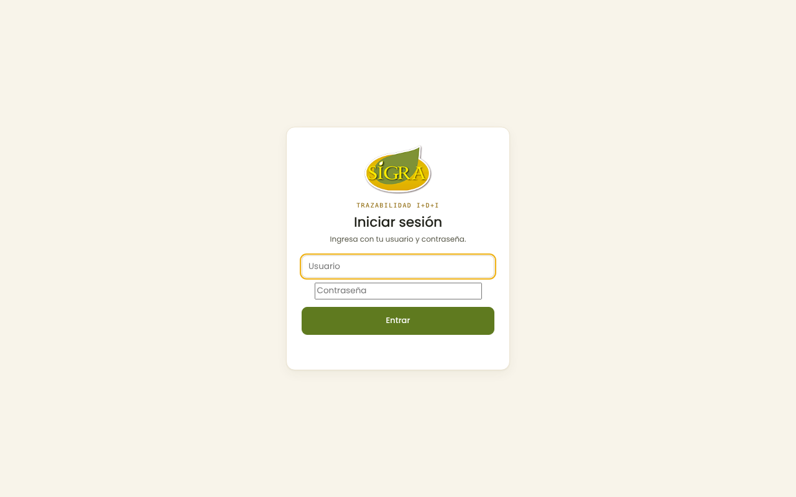
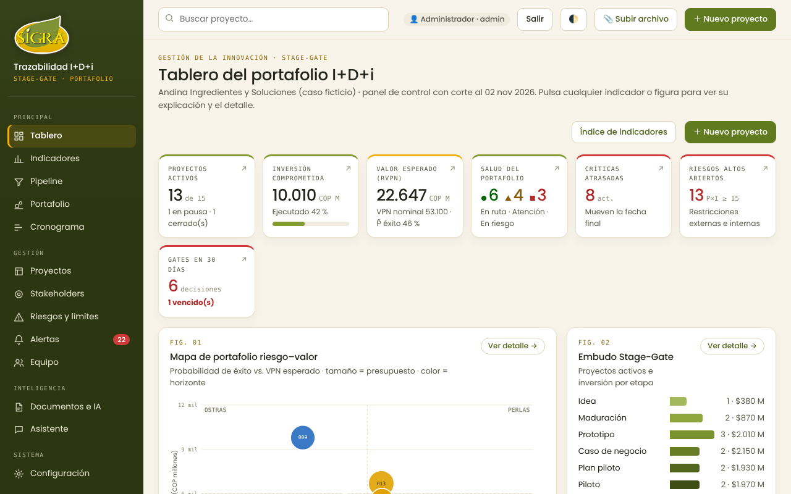
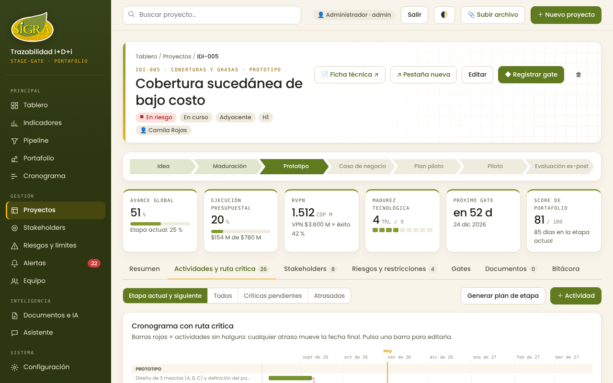
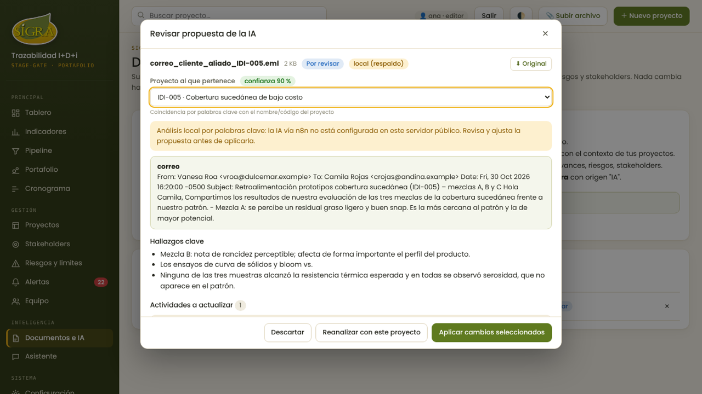
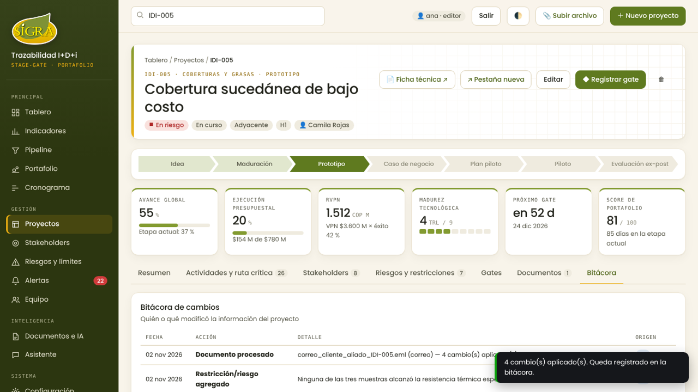
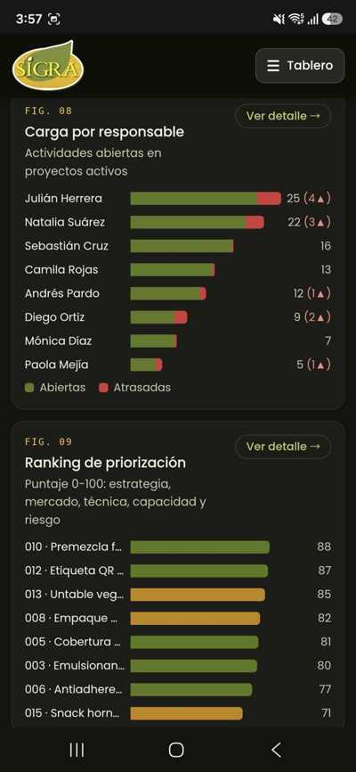
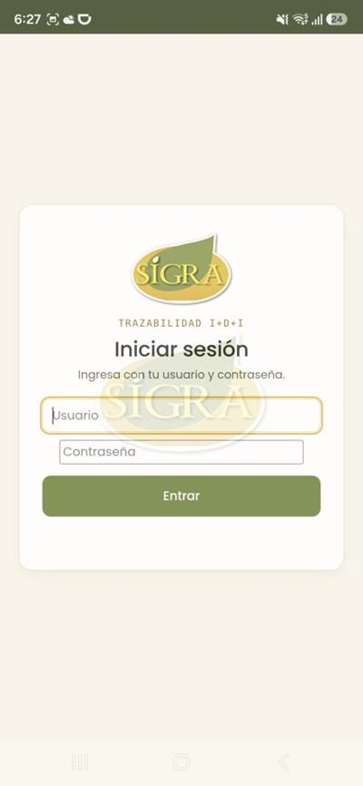

# Flujo principal y prototipo · SIGRA Trazabilidad I+D+i

**Autor:** Daniel Durán · Líder de Innovación · 2 de noviembre de 2026

## Cómo se prototipó

El flujo se definió a partir del problema (información dispersa y atrasos detectados tarde) y se prototipó directamente como software funcional construido con IA, en lugar de bocetos en papel. Cada versión funcionó como prototipo navegable: el autor la recorrió en el PC y en el celular, y con eso se corrigieron el diseño adaptable (v3.1) y el acceso desde la red. Las capturas siguientes documentan las pantallas del recorrido principal tal como quedaron en la versión publicada.

## Recorrido del usuario

**Objetivo del usuario:** actualizar un proyecto en riesgo a partir del correo de un cliente, sin copiar datos a mano.

| Paso | Pantalla | Qué hace el usuario | Decisión de diseño |
|-------|--------------------|-----------------------------------|--------------------------------------|
| 1 | Inicio de sesión | Entra con su usuario y contraseña | Un solo formulario corto con la marca SIGRA |
| 2 | Tablero del portafolio | Ve la salud del portafolio y detecta un proyecto en rojo | 7 indicadores arriba y figuras numeradas; todo es clicable y lleva al detalle |
| 3 | Proyecto y ruta crítica | Abre el proyecto y revisa qué actividades críticas están atrasadas | Barra de etapas Stage-Gate, indicadores del proyecto y cronograma con la ruta crítica resaltada |
| 4 | Revisión de la propuesta de la IA | Sube el correo, revisa lo que propone la IA y aprueba los cambios | Proyecto sugerido con confianza, cada cambio con casilla; nada se aplica sin aprobación |
| 5 | Bitácora | Verifica que el cambio quedó registrado con origen «IA» | Historial con fecha, acción, detalle y origen |

## Pantallas

### 1. Inicio de sesión

### 2. Tablero del portafolio

### 3. Proyecto y ruta crítica

### 4. Revisión de la propuesta de la IA

### 5. Bitácora del proyecto

## Versión celular

| Alertas en el celular | App instalada en Android |
|--------------------------------------------------|--------------------------------------------------|
|  |  |

En el celular, la barra lateral se reemplaza por un menú superior y las tarjetas de indicadores pasan a dos columnas.

## Validación del flujo

El recorrido se validó en dos momentos: una prueba piloto simulada (12 de 12 tareas completadas tras las correcciones) y pruebas con 3 usuarios reales del equipo de trabajo de SIGRA en PC, iPhone y Android. El detalle está en el *Informe de publicación y pruebas de usuario*.
